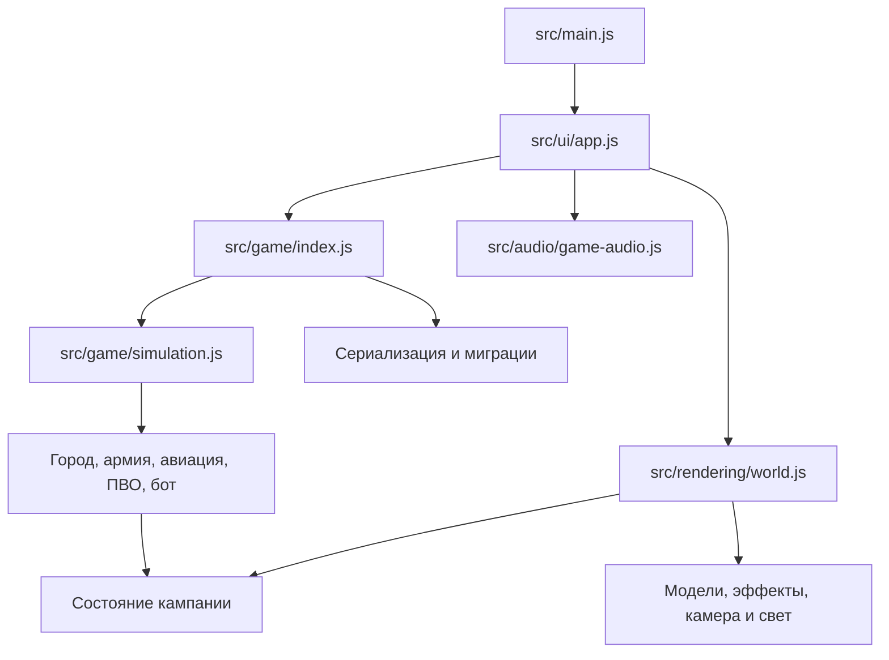

# Архитектура

Игра запускается двумя способами: готовый автономный `play/Skyfront.html` или исходные ES-модули через локальный HTTP-сервер. Обе версии собираются из одного `src/main.js`.

Игровые действия интерфейса проходят через `src/network/commands.js`. В одиночной кампании шлюз вызывает правила локально; в сетевой дуэли передаёт тот же разрешённый приказ серверу. `server/rooms.mjs` владеет сетевым состоянием и вызывает `step()` с шагом 50 мс. В режиме `state.mode === 'multiplayer'` отключаются обе системы бота и бонус его дохода. Клиенты не вызывают симуляцию и не записывают сетевые снимки в одиночное сохранение.

`network/perspective.js` скрывает закрытые данные противника и переводит собственную сторону в 0 для интерфейса. Координаты и ID остаются общими. `network/client.js` интерполирует движение между снимками, сохраняет номер команды при восстановлении и не применяет ответы старого соединения к новой сессии. Подробный контракт — в [MULTIPLAYER.md](MULTIPLAYER.md).

Правила в `src/game/` не используют Three.js и DOM. Они изменяют обычное состояние и публикуют события. Интерфейс отдаёт приказы через публичный API; рендерер и звук читают результат. Отрисовка не рассчитывает попадание или доход.

Интерфейс вызывает симуляцию с фиксированным шагом 0,05 игровой секунды. В `simulation.js` функция `step()` дополнительно ограничивает входящий шаг величиной 0,1 секунды. `advance()` используется сценариями и тестами. Бой зависит от `state.time` и генератора `random(state)`, поэтому одинаковый seed и приказы дают воспроизводимое состояние. Пауза останавливает симуляцию; камера продолжает работать по времени кадра.

Основные коллекции: `buildings`, `roads`, `groundUnits`, воздушные `units`, `projectiles`, `trenches`, `contacts`. Стороны находятся в `sides`, группы — в `groups`, настройки построения — в `formations`. Каждая сущность получает ID из `nextId`.

Граф дорог кэшируется по состоянию и его `networkRevision`. Создание или разрушение связей должно инвалидировать граф. Экономика и производство используют одну функцию снабжения, чтобы интерфейс показывал фактический выпуск.

Наземное движение и стрельба общие для солдат и машин. Отличия ролей задаются в `types.js`; специальные действия вынесены в `infantry/` и `vehicles/`. Пехота рисуется экземплярами по роли и стороне. Машины клонируют общие шаблоны геометрии, эффекты используют ограниченные пулы.

Освещение имеет одного владельца: `rendering/lighting.js`. Его направление зависит от игровых суток. Камера переносит область теней вместе с источником и целью; дополнительный сброс солнца из цикла камеры запрещён, поскольку именно он вызывал скачки света в 8.0.

Ключ кампании `skyfront-realtime-v3` и версия состояния `VERSION = 8` сохранены при переносе. `persistence/saves.js` обновляет старые кампании и проверяет входные числа/связи. Новая игра сначала сохраняет резерв и замену, затем перезагружает страницу; флаг `replacingCampaign` защищает от обратной записи старого прогресса обработчиком unload.

Рендерер предоставляет `window.skyfront` для локальной диагностики и браузерных проверок. Тестовые сценарии создают собственные браузерные профили и не обращаются к реальной кампании игрока.
