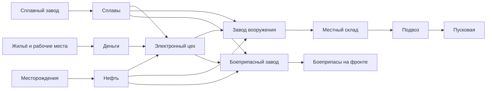

# Проект экономики: город обеспечивает войну

Дата: 28 октября 2026. Аудит опубликованной 8.13 (`7d528c9`). **Это проект
следующего изменения правил, а не уже внедрённый баланс.** В 8.13.1 экономические
runtime-правила остаются прежними; звуковой этап выполняется отдельно.

## Основное решение

Оставить четыре ресурса: деньги, сплавы, нефть и электронику. Электричество —
мощность инфраструктуры, а готовое вооружение/боеприпасы — физические запасы.
Не вводить еду, отдельный бензин, десятки микродеталей, исследования и новые
деревья. Интерес должен возникать из выбора расходов и защищаемых производств.

Для будущего интерфейса название «Промышленные материалы» точнее нынешних
«Сплавов»: один игровой ресурс обобщает металл, композиты и сырьё комплектующих.
Нефть обобщает топливо и нефтехимическое сырьё. В расчётах ниже слово «сплавы»
означает существующее поле `materials`; отдельные кремний/бензин не добавляются.

| Ресурс      | Откуда                                             | За что отвечает                                                |
| ----------- | -------------------------------------------------- | -------------------------------------------------------------- |
| Деньги      | Жильё, занятость, штаб, торговля                   | Строительство, содержание, найм, сборка и ремонт               |
| Сплавы      | Сплавные заводы, ограниченное снабжение/торговля   | Здания, броня, электроника, снаряды, восстановление            |
| Нефть       | Месторождения, дорогой импорт                      | Производство вооружения и техники, движение, часть боеприпасов |
| Электроника | Сплавы + немного нефти + деньги в электронном цехе | Управляемое оружие и перехватчики                              |
| Мощность    | Штаб и электростанции                              | Сколько промышленности и обороны работает одновременно         |

Формула выбора: «могу расширить доход, обеспечить текущую армию или подготовить
удар; на всё сразу ресурсов пока нет». Дополнительный завод увеличивает
производительность только при достаточных входах и реальном спросе.

## Что обнаружено в настоящем коде

Расчёт повторяется командой `node scripts/economy-report.mjs`. Это размерностный
аудит рецептов при полной мощности, здоровье и дорогах, без бонусов/боёв.

1. Один сплавный завод даёт **51 сплав/мин**. Один электронный цех производит
   10 компонентов/мин, расходует **40 сплавов + 3 нефти + 20 денег/мин** и отдельно
   36 денег содержания. Заполнение 120 компонентов стоит 480 сплавов, 36 нефти и
   240 денег до содержания. Цех делает этот запас без заказов, а остановить его
   существующим UI нельзя, хотя флаг остановки в модели уже есть.
2. HUD показывает несовместимые потоки. Деньги — доход минус содержание; сплавы —
   валовый выпуск; нефть — добычу минус двигатели. Автосборка, боеприпасы, ремонт,
   торговля и разовые покупки не образуют единой видимой картины. Например,
   показывается +51 сплав/мин, когда цех уже тратит 40 из них.
3. FPV-оператор стоит 110 денег и 8 сплавов и получает три заряда. Пополнение
   каждого забирает целый лёгкий дрон: 90 денег, 8 сплавов, 3 нефти и компонент.
   Новый оператор оказывается дешевле трёх пополнений и обходит нефть/электронику.
4. Два склада дают суммарно +30% выпуска плюс прямой доход; у hard-бота с +25%
   результат может достигать ×1,625 до вычета содержания. В кооперативе складской
   бонус получает владелец, а не распределённая команда. Это усиливает лидера.
5. При уничтожении всех сплавных заводов и отсутствии материалов базовые деньги
   сами по себе не позволяют восстановить промышленность. Цена замены растёт
   по пожизненным покупкам; снос не возвращает ресурсы.
6. Автоматический порт продаёт нефть относительно **ёмкости**, а не планируемых
   расходов. Увеличение хранилища меняет торговые пороги; резерв под удар может
   продаваться без понятного игроку решения.
7. Нельзя удваивать оплату выстрелов: `shotCost` уже только статистика, а реальные
   платежи происходят при выпуске конечных боеприпасов. SAM выпускается партией
   **2**, хотя магазин/груз может быть 4: с себестоимостью электроники один
   перехватчик стоит 17 денег, 4 сплава и 0,65 нефти при полной партии.

Пути: `city/economy.js`, `city/electronics.js`, `city/oil.js`, `city/ports.js`,
`city/pricing.js`, `city/ammo-production.js`, `units/ground/ammunition.js`,
`units/ground/recruitment.js`, `infantry/fpv.js`, `territory/districts.config.js`,
`ui/app.js`, `ui/inspector-card.js`.

## Правила предлагаемой экономики

### Производство по потребности

Электронный цех по умолчанию поддерживает **12 компонентов**, а не стремится
всегда заполнить 120. Действующий оружейный план автоматически повышает целевой
запас под ближайшую минуту неоплаченных заказов, обычно не выше 48. Ёмкость 120
остаётся потолком для намеренной подготовки больших запасов.

Оплаченные очереди не требуют повторного резервирования компонентов. Несколько
планов с общей целью не должны умножать один и тот же спрос. Пауза и конкретная
причина остановки доступны в той же карточке. Достигнутый запас — нормальное
состояние, а не ошибка и не повод уничтожать сырьё.

Все автозакупки используют общий видимый денежный резерв, первоначально 250.
Приоритет: восстановление критической инфраструктуры → снабжение существующей
обороны → пополнение заданного состава → новый наступательный запас. Внутри
приоритета очередь справедливая; броня не должна навсегда вытеснять пехоту.
Ручной оплаченный заказ выполняется раньше автоматического. Резерв не является
бесплатным ресурсом и не пополняется из воздуха.

### Нефть задаёт масштаб операций

Не расходовать её на зарплату бойца или каждую обычную пулю. Дешёвая пехотная
оборона и восстановление должны оставаться возможными после потери нефтевышки.
Движение брони, сборка летательного аппарата, перевозки и ракетные боеприпасы
имеют измеримый расход. Неподвижный танк не должен сжигать полный маршевый расход.

Ориентиры для отдельного балансного прогона: одна вышка обеспечивает небольшой
оборонительный гарнизон и периодические пуски; непрерывный смешанный удар и
несколько движущихся танков требуют второй, большая механизированная операция —
дальнейшего расширения. Начальные кандидаты движения: средняя броня 3–5,
тяжёлая 5–7, транспорт 1–2 единицы/мин непрерывного движения. Это кандидаты,
не проверенные текущие цены. Сначала измерить типичную долю времени движения.

Порт торгует относительно **операционного резерва**, а не процента бака. Резерв
состоит из ближайших подтверждённых заказов и 2–3 минут измеренного расхода.
Продажа заблокирована ниже него; импорт не опускает деньги ниже общего резерва.
Бак увеличивает длительность накопления перед операцией и запас при потере
добычи; сам по себе не даёт дохода. Резерв показывается в карточке порта.

### Одинаковая цена изготовления и пополнения

Стартовый боезапас не бесплатная лазейка: он включён в цену комплектной единицы,
а пополнение использует тот же рецепт боеприпаса. Для оператора нужна отдельная
короткодальняя FPV-поставка на существующем заводе вооружения, а не расход
полноценного дальнего дрона. Внешний HUD остаётся прежним: это тип изделия,
не пятый сырьевой ресурс. Плата за оператора и за его стартовый комплект
показывается общей суммой; компоненты/нефть комплекта оплачиваются один раз.

Лечение/ремонт должны быть дешевле соразмерной замены, но не возвращать брошенную
под огонь армию бесплатно. Для техники исходный кандидат — 20–30% пропорциональной
стоимости замены за восстановленную долю HP. Медики оплачиваются наймом и
содержанием; отдельная плата за каждое HP пехоты не нужна. Бонус снабжения от
нескольких машин должен иметь предел, а не ускорять перезарядку без ограничения.

### Рост города и риск расширения

Сохранить заказанную пользователем схему цены зданий: 50%, 75%, 100%, 125%, 150%
для каждого типа отдельно. Не менять её незаметно на счётчик живых построек.
Для восстановления руины нужна отдельная смета на том же фундаменте; она не
считается новой расширяющей покупкой. Историческая стоимость строения хранится
явно; миграция старых сохранений не должна выдумывать оплаченные суммы.

Жильё даёт базовые налоги и заметную надбавку от занятости. Кандидат без общего
усиления денежного потока: база 3,2/с вместо 3,8, доход занятого работника 0,12/с
вместо 0,07. При десяти занятых и содержании 0,25 получается 249 денег/мин против
нынешних 255; пустое жильё слабее. Заводы не блокируются целиком из-за отсутствия
работников: дорога и энергия остаются основными понятными требованиями.

Поселения используют те же дома/предприятия, мощность и содержание. Новый
удалённый доход увеличивает защищаемую территорию: это выбор риска, а не
бесплатный независимый денежный генератор.

Для складов предлагается заменить процент всей экономики фиксированной поставкой.
Начальный кандидат одного исправного склада: 90 денег, 18 сплавов и 6 нефти/мин
на команду, с делением между городами этой команды с живым штабом. Отключение
игрока не меняет долю его города; уничтожение штаба меняет её только со следующего
интервала поставки. Два игрока не создают второй
экземпляр груза. Такой бонус заметен на старте и не растёт автоматически вместе
с уже большой экономикой. Проверить ценность склада и возможность отбить его.

### Медленное восстановление возможно

Не гарантировать положительные деньги **после** содержания: такой минимум
субсидировал бы армию любого размера. Восстановление не должно оплачивать зарплаты
или создавать доступные для найма ресурсы.

Предлагается целевой гражданский заказ в штабе при отсутствии действующей
подключённой промышленности. В него постепенно направляется существующий базовый
доход штаба, а не добавочный доход; этот расход явно показывается в бюджете.
Единственная цель — восстановить один сплавный завод и его подключение по полной
фиксированной смете. Закупленные для заказа материалы закреплены за ним и не
доступны оружейным/военным очередям. Это прогресс обычного заказа, не пятый
расходуемый ресурс. Увеличение бонуса сложности не ускоряет эту защитную процедуру.

Отдельный кошелёк проекта не покрывает армейское содержание; при пустой общей
кассе автопополнение/платные боеприпасы по-прежнему ждут. Не выдавать деньги при
отмене/повторном запуске и не дублировать контракт после загрузки. При обычной
экономике заказ выполняется за счёт общей кассы быстрее и на тех же условиях.

Критерий завершения — завод реально работает и имеет дорогу, **либо** для уже
размещённого здания полностью зарезервирована смета недостающего подключения.
Сам факт наличия недостроенного завода не прекращает помощь. Нельзя молча
восстановить прежний масштаб промышленности: один заказ, одно предприятие,
обычное время строительства, открытая уязвимость для повторной атаки. Срок и
цена такого восстановления требуют отдельного теста худшего случая: ноль денег
и сплавов, содержание выше дохода, разрушенная дорога/электростанция, повторные
атаки, намеренный снос и сохранение посередине заказа.

## Что должен видеть игрок

Четыре одинаково заметные ячейки: деньги, сплавы, нефть `150/200`, электроника
`12/120`. Один индикатор мощности: `50 из 52 · свободно 2`. Не скрывать отдельный
расходуемый ресурс внутри подписи другого.

У всех скоростей одинаковое определение: **фактические поступления и списания за
последнюю минуту**, а не обещание будущего темпа. После короткой игры нормировать
на фактически прошедшее время и помечать короткое окно. В раскрытии отдельно
видны добыча, производство/содержание, торговля и разовые заказы. Прогноз истощения
строится только по устойчивым операционным расходам, без экстраполяции одной
покупки здания. Доставки между своими складами не являются новой добычей/расходом.

Карточка цеха: `Работает · +10 электроники/мин`, ниже `−40 сплавов · −3 нефти`,
`Цель 12 · сейчас 8/120` и компактная пауза. Подробный рецепт/характеристики
свёрнуты. Дефицит сообщает количество: «Нужно 6 компонентов, доступно 4».
Различать дорогу, мощность, отсутствие сырья, заполненный склад и груз в пути.

Названия: «Сплавный завод», «Электронный цех», «Завод вооружения», «Пусковая
дронов», «Ракетная пусковая». Сырьё общее в пределах города; готовое оружие
хранится в конкретном здании/машине/пусковой. В кооперативе города не имеют
незаметно общей кассы.

## Пример решения, а не обязательный порядок строительства

Сначала игрок обеспечивает положительный бюджет, металл и запас мощности.
Затем выбирает ветку расходов: казармы и боеприпасы для фронта; либо цех,
завод вооружения и пусковую для налётов. Вышка позволяет перейти от стартового
запаса нефти к повторяемым операциям. Второй одинаковый завод нужен при
недостаточной скорости, а не как универсальный ответ на любую остановку.

Для масштаба по **нынешним** рецептам, с учётом изготовления компонентов:

| Заказ                                                                      | Деньги/мин | Сплавы/мин | Нефть/мин | Компоненты/мин |
| -------------------------------------------------------------------------- | ---------: | ---------: | --------: | -------------: |
| 3 лёгких дрона/мин                                                         |        276 |         36 |       9,9 |              3 |
| 1 баллистическая ракета/мин                                                |        670 |         92 |        28 |             10 |
| 6 лёгких + 2 тяжёлых/мин, крылатая раз в 2 мин, баллистическая раз в 4 мин |     1263,5 |        173 |      48,4 |           15,5 |

Последней строке нужно минимум **4 сплавных завода, 2 вышки, 2 электронных цеха и
3 оружейных завода** по идеальной пропускной способности. Здания, энергия,
содержание, армия, боеприпасы, доставка и ремонт ещё не оплачены этой таблицей.
Расходы на компоненты уже входят в первые три столбца; нельзя складывать их второй раз.
Первоначальное заполнение лишних запасов может временно увеличивать этот расход.

## Порядок внедрения и приёмка

1. Единый журнал реальных поступлений/списаний, отображение причин, пауза цеха.
   Обычный расход и перевод груза различаются. Интерфейс не запускает пересчёт
   всех юнитов при каждом клике; сводка обновляется ограниченно по времени.
2. Спрос/целевые запасы электроники и единые резервы автопроизводства.
3. Честная цена стартового FPV/боезапаса и повторного снабжения.
4. Резерв нефти и безопасная торговля; затем измеренный расход активной техники.
5. Фиксированные складские поставки, восстановление, занятость и AI. Согласовать
   изменения схемы/протокола только после определения новых сохраняемых полей.

Обязательные сценарии: оборона/дроны/механизированная армия на 10–30 мин;
потеря дороги/мощности/нефти/всей промышленности; ноль денег и металла; полный
склад; пакетный и единичный боезапас; смерть/повторный найм оператора; импорт
при малом бюджете; два игрока против двух ботов; переход/потеря склада; частые
save/load. Проверить равенство сырьевых балансов и оплаченных грузов, отсутствие
отрицательных запасов, дублирования, кражи резервов и скрытых бонусов боту.

Успех: игрок может объяснить причину паузы за несколько секунд, текущая армия
обеспечивается раньше расширения, есть несколько жизнеспособных направлений
развития. Бездействие может накопить запас; обычный прогресс не требует бесконечно
нажимать кнопки или всегда немедленно тратить всё. Поражение экономики значимо,
но не превращается в невидимый программный тупик.

## Внешние ориентиры

- [Factorio: production statistics](https://wiki.factorio.com/Production_statistics) —
  наблюдаемые входящие/исходящие потоки и временное окно. Для нашей игры вывод:
  показывать конкретное ограничение и не путать валовый выпуск с накоплением.
- [Age of Empires IV: French](https://www.ageofempires.com/games/age-of-empires-iv/civilizations/french/) —
  торговля как способ получить нужный ресурс при дефиците. Для нашей игры вывод:
  импорт — дорогая страховка с временем доставки, а не замена своей добычи.

Числа и предлагаемые механики выше — собственный проект под текущую игру,
не копия цен/ресурсов этих игр и не утверждение о проверенном боевом балансе.
